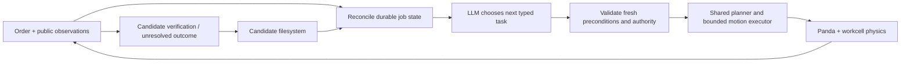

# A1 — Durable Task Dispatcher

**Proposed architecture · Batch 01 · revision B01-A1-r1.** This is a complete mechanism design, not a measured result or an implemented robot. The [shared contract](../../Batch%2001/Shared%20Implementation%20Contract.md) supplies common resources and experimental boundaries. Later implementation receives a new immutable revision.

## The robot's job and the language model's responsibility

The Panda must load, process, inspect and route the right distinct parts under a changing order. The LLM decides what consequential task to do next from current public observations and retrieved durable context. It may choose a motion, ask for another observation, await a public condition or request help. It does not invent motor competence or certify that a physical job is finished.

Only one model invocation is outstanding. The executor runs concurrently and the physical world does not wait for it. This is one reasoning process with separate conventional transport, control and storage components, not a team of conversational agents.

## Inputs, decisions and actual control

The model receives the effective order with version, currently visible tagged objects with timestamped pose estimates/uncertainty, public machine and gripper state, compact task commitments, unresolved commands, recent contradictory observations and a bounded selection of relevant prior outcomes. Source event IDs distinguish observation from inference. A missing tag means unseen, not absent. The model never reads private evaluator process history or expected answers.

The output is a schema-checked object: operation, part or device target, intended destination/recipe, order version, evidence IDs, success condition and a short observable rationale. Operations reference frozen public services: observe; transport a visible part; operate the fixture/guard; request an eligible cycle; inspect at the pad; wait on a public condition; request assistance; declare the order believed complete. A declaration merely asks the evaluator to check. Parameters must name known public IDs, finite calibrated targets and allowed resources.

A deterministic admission layer checks the proposal against the *current* order and observation version. It rejects an old destination after an amendment, an unknown object, illegal cycle, conflicting resource, expired observation or unsupported condition. It is not a second hidden planner. Rejection returns public cause and fresh facts; the LLM must choose again. A timeout produces a hold rather than a fabricated next task.

The shared motion library turns admitted transport into approach, grasp, lift, transit, lower, release and retreat. Numerical planning uses only sensed geometry and the public static workcell. Joint targets go to the common actuator layer; contact and object motion are simulated. Grasp or placement can fail. The executor reports command status and sensor feedback, not a success oracle. Candidate verification requires fresh visible object location and gripper/state evidence; recipe and inspection evidence come only from lawful public observations retained at their acquisition time.

The language model can alter task ordering and recovery decisions online. It cannot alter its own executable code, the shared motion library, safety limits, evaluator, sensor contract or model weights. Motion-level alternatives remain the library's fixed capabilities; if those are insufficient, the architecture fails or asks for help.

## Filesystem continuity

The episode directory contains a versioned order snapshot, an append-only consequential-event journal, a compact job projection, unresolved-action records and acquired procedure notes. These names are an A1 implementation choice, not a shared architectural prescription. Each entry retains source IDs, observation acquisition time, order version and whether it is observed, inferred, intended, dispatched or verified.

Before an irreversible command, persist the unique request and its preconditions. After acknowledgement, persist its dispatcher status. After fresh evidence, append outcome verification and update the projection atomically. Retrying the same ID within the dispatcher window returns its original receipt. A new ID cannot be used to hide an uncertain previous action. Projection updates use flush and atomic replacement; a torn final journal entry remains a recorded recovery condition and does not imply the previous command failed.

On restart, allocate a new incarnation, invalidate pending language output, replay intact journal entries and mark every unverified action unresolved. Obtain current order, public machine state and fresh observations. Reconcile changed facts before selecting a task. If a part cannot be seen, deliberately observe from another supported viewpoint or request assistance rather than constructing a hidden inventory. A saved cycle request does not prove the cycle completed; a saved location does not prove the part stayed there.

Retrieval prioritizes current order, unresolved actions, commitments for currently relevant parts and contradictory observations. Older procedural notes enter only when their public applicability conditions match. Record both bytes that survived and bytes actually delivered to the model; storage alone does not establish retrieval or use.

## The same ambiguous restart, concretely

This is a **schematic example**, not a run. Part A2 has been processed, inspected and commanded to tray T1. The runtime dies just after release, before recording visible placement. During a 60-second absence the order changes its destination to T2 and an external actor moves the unheld part to parking P1.

The durable journal contains the old intent and receipt, not verified delivery. The restarted dispatcher reads order v2 and obtains a fresh view showing A2 in P1. It cannot count A2 in T1, and cannot automatically repeat a process cycle. It retrieves previously observed inspection/cycle evidence, proposes moving A2 from P1 to T2, then verifies its new visible resting location. If A2 is occluded or the earlier inspection evidence did not survive, it observes or reinspects through the public pad. What actually happens is determined by the future executable and experiment trace, not this narrative.

## Timing and expected tradeoffs

Call at consequential task boundaries, after a rejected request, after unexpected feedback, on order amendment or after restart reconciliation. Do not call once per physics tick. A currently authorized bounded trajectory may continue while the next decision is being computed, but no new task starts until admission. Leases expire within the common two-second bound and renew only against fresh valid execution conditions.

Hypothesis: deliberate task-level reconciliation will retain correct long-horizon intent without requiring language inference for every servo update. Risks: frequent calls between motions cause hesitation; a small model may choose poor buffer ordering; verbose history may hide an unresolved action; competent fixed rules may outperform the model on structured orders. Better task behavior would not demonstrate improved low-level control because that controller is shared.

## Model, controls and falsifiable checks

Use the same official Qwen3-4B-GGUF Q4_K_M local model, thinking disabled, and settings as A2/A3 after calibration. No runtime model or weights are frozen at this proposed revision. No new accounts, spending, external tools or pretrained robot-policy assets are required by this design. SayCan supplies conceptual orientation toward language-guided skill choice; this design does not reproduce its learned affordance mechanism or inherit its reported performance.

The no-persistence condition deletes private episode records at restart while preserving frozen code, current public orders and the same bounded receipts. It must still function from current observation and escalate uncertainty; no compensating hidden ledger is allowed. Uninterrupted controls distinguish persistence overhead from restart survival. Compare the conventional durable sequencer separately, with identical motion primitives and observation permissions.

Useful tests include crash before/after dispatch, release before verification, an expired receipt after absence, an amended destination during inference, torn projection writes, invisible stock, failure to achieve a grasp and occupied buffers. Measure false completion, duplicate cycles, correct reconciliation, full/partial job outcome, inference/idle time and paired motion quality. A1 is contradicted as a useful addition if it costs more and improves none of these relative to the durable conventional baseline.

## What still has to exist

The executable candidate, physical workcell, image-derived tag service, motion library, protected IPC/dispatcher, scoring predicates, isolation checks, local inference and actual resource budgets are implementation work. This snapshot registers the mechanism honestly as proposed. No candidate run, success rate, physical recovery or commercial suitability is asserted.

Sources: [SayCan author description](https://say-can.github.io/) and local literature ID `arxiv:2204.01691`; [Qwen author model card](https://huggingface.co/Qwen/Qwen3-4B-GGUF). Read the former for language/feasibility separation, not evidence about this architecture.
