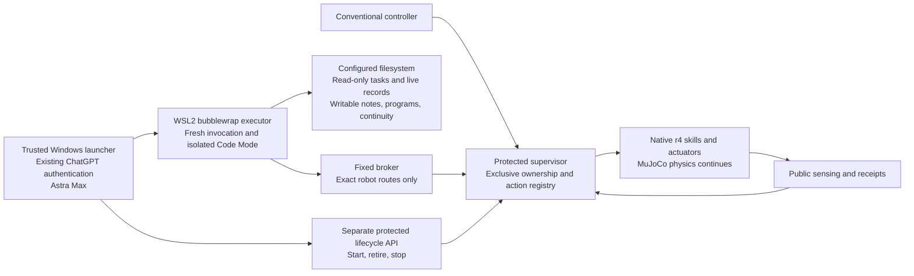

# Filesystem-native recovery inside an enforced invocation boundary

The normal worker remains the frozen r4 Panda/MuJoCo machine-tending controller. It chooses native skills from public observations until its existing help rule activates recovery. A protected supervisor then gives one fresh Robot-Codex invocation a capability for the current task and authority generation. The agent reads the configured filesystem, investigates the incident, requests bounded operations, checks public feedback, and asks the supervisor to return control. The independent evaluator remains outside the agent's filesystem and observations.

The sole model input is `Follow the instructions in RobotAgentPrompt.md.`. Automatic project instructions, skills, memory, apps, MCP tools, web, local execution and subagents are disabled. Effective configuration and actual dispatch are retained; this is not an exhaustive exported live model-tool schema. The installed Windows client holds authentication. No account credential is read, copied into WSL, or substituted with an API key.

Both the Linux executor and Code Mode host have separate bubblewrap namespaces. Windows drives, user homes, repository, reference plans, evaluator, concealed development manifests and ambient networking are absent. Read-only system runtime libraries support command execution. The broker accepts only fixed status/history/query/observation/continuity/command/handback routes, validates bounded JSON and keeps the upstream origin and token fixed for that invocation. Operator routes never enter this broker. Structured robot observations are available; model image viewing remains disabled, even though requested public image artifacts can be retained.

The protected owner thread alone changes the simulator. It admits commands with stable request IDs, current authority/task revision, fresh observation sequence, native limits and equipment interlocks. It retains requests before dispatch and separates requested, admitted/executing, terminal, and public post-action support. A receipt is not proof of a grasp, placement or task success. Uncertain commands are queried; the client does not silently retry or acquire a new authority generation.

The OS boundary supports agent-written shell/Python. A documented Python runner seals a versioned source snapshot before execution, retains its admitted hash/bytes before process creation, limits source/output/time and per-child memory, and retires detached descendants. Its final receipt is separate; an admission with no final outcome remains unknown. This is a convenience within the invocation's permissions, not a second privilege boundary. All scripts share the same gateway limits and cannot create a persistent controller outside namespace retirement. There is no dedicated privileged program service or simulator/driver access.

The launcher owns the invocation deadline. A separate protected capability starts and retires invocations; the public agent cannot call it. Retirement revokes robot access and fences already queued requests, while restart preserves action budgets and unresolved outcomes. The launcher must verify all prior executor/Code Mode namespaces retired before admitting a fresh thread. After handback, retirement preserves newly resumed conventional motion. Old tokens remain unusable even if the old client saved them.

Runtime backing lives under a dedicated WSL `/var/tmp` directory. The public `Continuity.md` is a fixed symlink to a file inside a writable directory, so atomic replacement becomes visible without replacing a bind-mounted inode. The protected continuity service saves old and newly committed notes before acknowledging them; the broker atomically publishes the committed bytes into WSL. Fresh invocation initialization uses the protected committed note and retains older local bytes separately for reconciliation. Public state/activation/structured-observation mirrors refresh while the simulator advances. Actual HTTP status/history remains the current public interface.

The trusted harness fsyncs model and broker traces, exports bounded actual runtime bytes even after client failure, and compares retained hashes after namespace/broker teardown. Each tested revision has an immutable source archive and attempt manifest in the Architecture Map. Dynamic runtime input hashes, effective binary/configuration evidence, queue receipts and independent assessments identify the exact attempt. Old failed native and WSL attempts are preserved.

This architecture supports bounded simulation development, not physical deployment or a scored release by itself. Full supervisor/computer restart recovery, power-loss recovery, disk-full operation, aggregate resource exhaustion, complete whole-arm/contact protection and general recovery performance are unqualified. A host crash terminates and invalidates the episode; it does not automatically restart a possibly ambiguous physical task. Resource/deadline failures retain their outcome and require operator handling. The single authorized development pilot cannot estimate performance, and no campaign starts without Randy's review.
