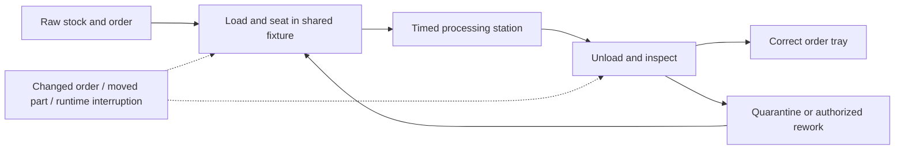

# Long-horizon adaptive robotics experiment

**Design for Randy's review · 22 September 2026 · architecture design has not begun.**

Can a complete robotic system keep a useful job moving when actions fail, orders change, and its reasoning process loses context or restarts? Later we will compare different uses of LLMs against competent conventional automation. This package fixes the arena and evidence requirements while leaving those uses open.

The chosen job is **small-batch machine tending with order changes and exception handling**: take identified blanks from staging, place them correctly in a fixture, run a process, unload, inspect, and route each part to its order tray or quarantine. A finite buffer and shared fixture couple earlier work to later choices. A simulated processing station represents machine availability and process state; it does not simulate cutting metal.

Imagine the arm has unloaded a part when its runtime disappears. On return, the order has changed and the part is no longer where the last observation placed it. Issuing the old command again could duplicate work or put the wrong part into a completed order. The test asks whether the system reconciles its records with the physical scene and resumes useful work, and what that reconciliation costs in time, motion, and human help.

This is a schematic of the job, not a candidate robot architecture.

## Read in this order

| Document | What it settles |
|---|---|
| [Arena](Arena.md) | Commercial choice, scene, body, job dependencies, disturbances, completion |
| [Experimental contract](Contract.md) | Observation permissions, action interfaces, continuity, protected evaluator, timing |
| [Comparison and measurements](Evaluation.md) | Development versus evaluation, baseline, memory controls, operational metrics |
| [Evidence and investigation](Evidence%20and%20Investigation.md) | What to log, how to replay, and how Randy will investigate future results |
| [Sources and feasibility](Sources%20and%20Feasibility.md) | Primary evidence, alternatives, resource check, bounded probe, uncertainties |

The consequential choices to inspect are the tending task, the controlled-perception first stage, the continuously advancing world, and the paired continuity ablation. The arena uses a simulated seven-axis Franka Panda and parallel gripper in MuJoCo; this is a simulation proxy, not a hardware purchase or claim that a Panda is affordable. A conventional system may win.

All numerical arena settings are **proposed engineering defaults**, not measured task results. Hardware/simulator facts and the tiny installation/render/state probe are separately labeled in the source document. The workcell, evaluator, controllers, logging service and investigation interface remain to be built after review; no architecture comparison has run.

## Boundary and next decision

This design adopts a task, embodiment, and evaluation contract for review. It does **not** select a runtime model, an LLM location, agent count, memory file layout, code-generation policy, or competing architectures. Every future main candidate must include persistent filesystem continuity; simpler-memory controls are ablations. The conventional baseline retains its ordinary durable job state.

After Randy reviews this package, the next assignment can be: **Design several meaningfully different complete architectures to enter this experiment.** Do not start that phase automatically. Open engineering uncertainties are collected in [Sources and feasibility](Sources%20and%20Feasibility.md#unresolved-questions-and-next-gates); none requires choosing a candidate architecture now.
