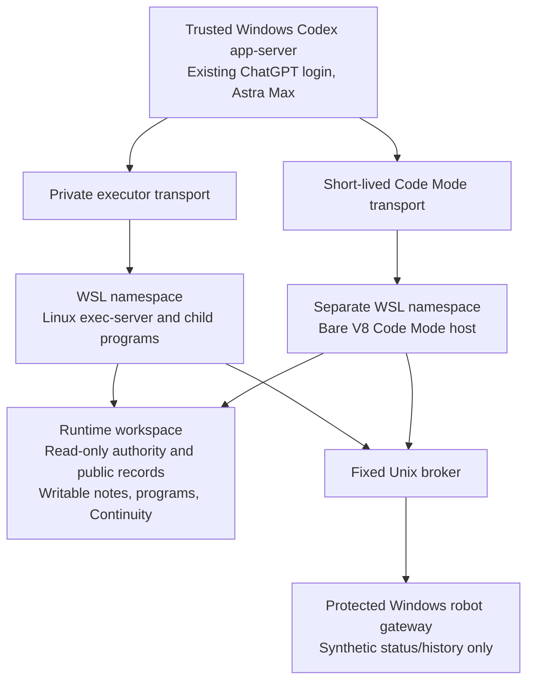

# Session 9: focused Robot-Codex isolation qualification

Randy authorized one engineering session to demonstrate an enforceable boundary, followed at most by an actual exact-bootstrap check. This folder preserves each attempted route and its evidence. No robot experiment, recovery pilot, new challenge, scored campaign or Maps + Attention work belongs to this session.

The strongest demonstrated OS boundary is the existing **WSL2 + bubblewrap** stack. It confines the entire credential-free Linux Codex executor, its file RPCs and child programs. The required Code Mode host is separately confined under the same policy. The trusted installed Windows Codex app-server retains the existing ChatGPT subscription login; credentials never enter either namespace.

**Outcome: the isolation boundary and an actual Astra Max bootstrap were demonstrated.** In `bootstrap-003`, all eight required startup-file read outputs match their frozen input hashes; Robot-Codex ran all 28 boundary canaries, wrote both observation files and continuity, and successfully read back/asserted its writes. The exact prompt, ChatGPT account type, effective model/effort and command traces are retained. [Independent retained-trace verification](wsl/records/bootstrap-003/retained-bootstrap-verification.json) records every check.

There is a concrete launcher qualification limit: the outer runner returned failure after the successful model turn because it treated the trusted Windows client's shutdown connection reset as a transport fault. Its original failure remains. Both namespaces nevertheless retired successfully. Expected-shutdown handling was corrected; separate nonmodel HTTP/2 abort/retirement probes passed, although they delivered EOF rather than reproducing the exact Windows reset. **The fully corrected launcher was not rerun with a model.** The failure interrupted raw artifact export, and the temporary WSL runtime was absent on a later startup. Durable output records are explicitly derived from retained successful commands/readback assertions, not presented as later raw-file exports. This is enough to demonstrate the requested bootstrap behavior, but not a clean end-to-end production-launcher release.

Both namespaces omit Windows drives, user homes, the development repository and evaluator/reference evidence. They have no external network route, no Windows interop and no ability to create another user namespace. Read-only `/usr`, fresh `/proc` and `/dev`, and disposable `/tmp` provide the operating-system runtime. Only the explicit runtime write areas are persistent writable mounts. The broker fixes both destination and allowed read routes; it disables proxy discovery and redirects. No actuator exists in this fixture.

## Evidence map

| Lane | Result and record |
| --- | --- |
| Native Codex restricted sandbox | Session 8 root-deny refusal, Users ACL failure and setup timeout remain unchanged. A new strict unelevated attempt refused because restricted read access requires the elevated backend. [Native diagnosis](native/README.md) identifies what is and is not explained. |
| Separate Windows identity | Existing sandbox identities inherit repository read access and ordinary outbound networking. A new identity would need additional provisioning and tested network enforcement. No identity was borrowed or created. [Inventory](options/README.md). |
| Native AppContainer | Actual restricted token and bounded file/network checks passed; a synthetic fixed mailbox broker worked. Direct loopback did not qualify. This is a working primitive, without demonstrated full Codex integration. [AppContainer evidence](appcontainer/README.md). |
| Existing WSL2 + namespaces | 28 filesystem/network canaries, direct executor file/process RPCs, permitted gateway use and detached-child disconnect cleanup passed. [WSL implementation and attempts](wsl/README.md). |
| Additional VM/container stack | Windows Home lacks supported Windows Sandbox/full Hyper-V; no Docker/Podman or checked third-party stack was installed. The already available WSL route made another installation unnecessary. [Inventory and official binary provenance](options/README.md). |

## Interpretation and remaining scope

Passing a namespace probe is distinct from a successful model bootstrap. `client/result.json` records the app-server transport result; `bootstrap-assessment.json` assesses actual task artifacts. In particular, `wsl/records/bootstrap-001` completed an Astra Max turn but **failed the bootstrap**, because Code Mode was disabled. It did not read the required files or produce the required outputs. Its failure is retained.

Three actual model turns occurred: 001 failed for disabled Code Mode, 002 failed after a relay timeout, and 003 demonstrated the task with the shutdown limitation above. No model was used by the other preflight, boundary, protocol, lifecycle or retained-trace checks. No robot trial ran.

The client verifies effective `gpt-6-astra` / `max`, ChatGPT account type, no automatic instruction sources, no configured local executor, a ready explicit remote environment, and disabled MCP/app/browser/web/skills/memory/subagent surfaces. Remote Code Mode selects a gRPC provider with no local-provider fallback in the inspected release source. See [native startup/source evidence](native/README.md). The available app-server API does not return the complete model tool schema; configuration checks, source routing and actual dispatch traces are the evidence, not a claim of exhaustive tool enumeration.

This is development bootstrap qualification, not a scored release or a security proof against all kernel vulnerabilities. The trusted Windows harness and brokers remain outside the agent boundary. The short-lived gRPC bridge assumes other same-user Windows processes are trusted; it is not a multi-user service. Resource exhaustion, full-host restart, actuator bridge integration, per-program resource limits and atomic replacement of the bind-mounted continuity file are not qualified here. The generic framework, prior Batch 01 results and Session 8 implementation/evidence are unchanged.

Randy should review the actual bootstrap result and these remaining limits before authorizing the next bounded integration step. No recovery campaign is authorized by this qualification.
